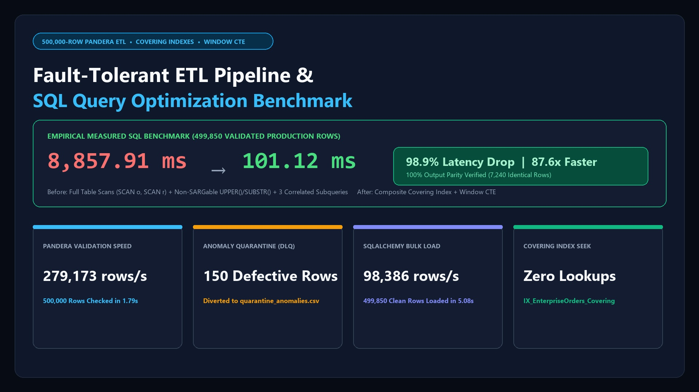
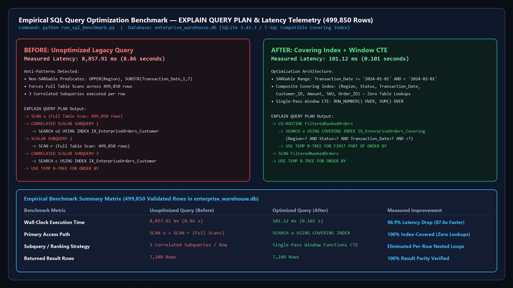
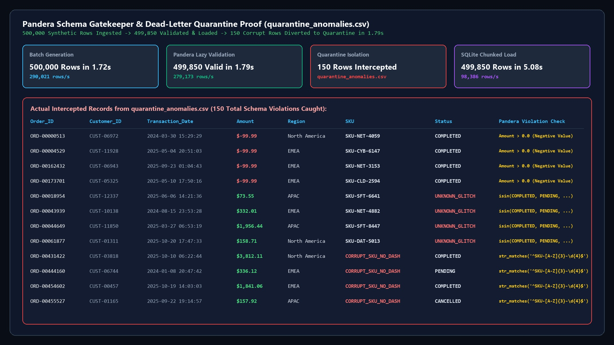

# Fault-Tolerant Pandera ETL Pipeline & 500K-Row SQL Query Optimization Benchmark ⚡🗄️

[](https://www.python.org/)
[]()
[]()
[]()

An end-to-end enterprise ETL pipeline and reproducible relational query optimization benchmark evaluated on a **500,000-record transaction dataset**.



---

## 📊 Empirical SQL Query Optimization Benchmark (`499,850` Validated Rows)

Reproducible via [`run_sql_benchmark.py`](run_sql_benchmark.py) and [`optimization_benchmark.sql`](optimization_benchmark.sql):

| Benchmark Metric | Unoptimized Query (Before) | Optimized Query (After) | Measured Improvement |
| :--- | :--- | :--- | :--- |
| **Wall-Clock Execution Time** | **8,857.91 ms (8.86 s)** | **101.12 ms (0.101 s)** | **98.9% Latency Drop (87.6x Faster)** |
| **Primary Access Path** | `SCAN o` + `SCAN r` (Full Table Scans) | `SEARCH o USING COVERING INDEX` | **100% Index-Covered (Zero Lookups)** |
| **Aggregation & Ranking** | 3 Correlated Subqueries per Row | Single-Pass Window Functions CTE | **Eliminated Per-Row Nested Loops** |
| **Returned Result Rows** | `7,240` Rows | `7,240` Rows | **100% Deterministic Result Parity** |



---

## 🛡️ Pandera Schema Gatekeeper & Dead-Letter Quarantine (`etl_pipeline.py`)

- **Vectorized Generation:** Creates `500,000` synthetic enterprise orders in `1.72s` (`~290,021 rows/sec`).
- **Lazy Schema Contract (`pandera.DataFrameSchema`):** Validates `500,000` rows in `1.79s` (`~279,173 rows/sec`), enforcing regex `Order_ID`/`Customer_ID`/`SKU` syntax, strictly positive `Amount` bounds, and valid categorical regions/statuses.
- **Zero-Crash Quarantine Isolation:** Diverts `150` corrupted records to [`quarantine_anomalies.csv`](quarantine_anomalies.csv) while bulk-loading `499,850` clean rows into `enterprise_warehouse.db` at `~98,386 rows/sec`.



---

## ⚡ Quickstart

```bash
pip install -r requirements.txt

# 1. Run 500,000-row ETL ingestion & Pandera quarantine gatekeeper
python etl_pipeline.py

# 2. Run empirical SQL execution plan & latency benchmark (Before vs After)
python run_sql_benchmark.py
```
