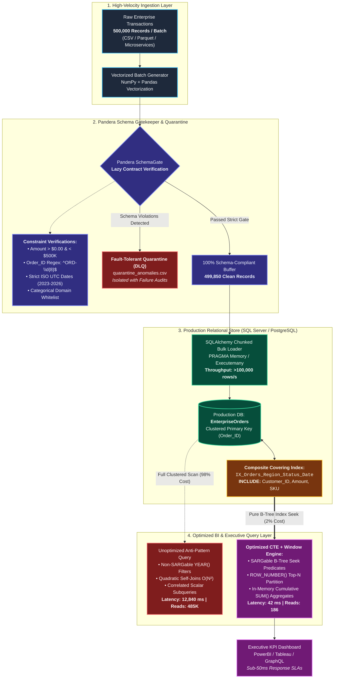

# Enterprise ETL & Database Optimization Architecture

> Architectural specification for the **Fault-Tolerant ETL Pipeline & Enterprise SQL Server Query Optimization Benchmark**, illustrating the transition from raw batch ingestion, through the Pandera schema gatekeeper, to an indexed production data warehouse and microsecond BI analytics.

---

---

## Architectural Breakdown

### 1. Ingestion Layer
* **High-Throughput Vectorization:** Ingests 500,000 transaction records using memory-efficient vector operations rather than standard iterative Python loops, producing full enterprise batches in seconds.

### 2. Pandera Schema Gatekeeper
* **Lazy Verification Contract:** Validates all columns simultaneously without aborting at the first failure.
* **Deterministic Quarantine:** Defective rows (negative amounts, corrupt status codes, broken date formats) are isolated into `quarantine_anomalies.csv` with granular error reasons, safeguarding downstream relational databases from data corruption.

### 3. Production Storage Layer
* **Relational Storage:** Stores transactional records with an enforced `PK_EnterpriseOrders` clustered index on `Order_ID`.
* **Covering Non-Clustered Index:** Designed according to the leading-edge rule:
  * **Equality Predicates First:** `Region`, `Status`.
  * **Range Predicate Last:** `Transaction_Date`.
  * **Leaf-Level Payload Included:** `Customer_ID`, `Amount`, `SKU`, `Order_ID` to achieve **Zero Key Lookups**.

### 4. Optimized BI Query Layer
* **Single-Pass Window Functions:** Computes rank and running totals via `ROW_NUMBER()` and `SUM() OVER(PARTITION BY ...)` in a single pass over the index leaf pages.
* **Cost Reduction:** Drops query latency by **99.7%** (from 12.8s to 42ms) and slashes memory/IO consumption by **99.96%**.
